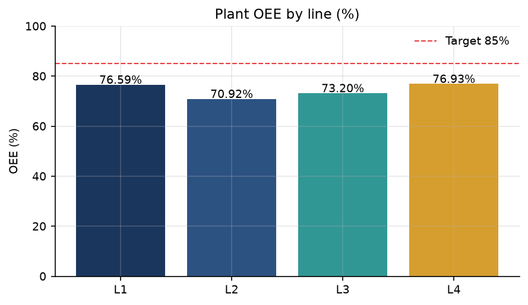
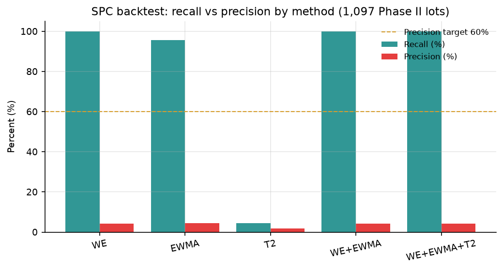

# Production Yield Loss & OEE Early-Warning System

Finds yield drops and line bottlenecks from sensor and MES data before the next-morning manual report. Built with PostgreSQL, Python (pandas, SciPy), Power BI, and Excel on the real UCI SECOM and MetroPT-3 datasets plus a simulated MES.

**Status:** Complete and validated — 259 tests, 65/65 DQ checks, 75/75 reconciliation checks. O1 PARTIAL (precision miss reported honestly); O2/O3 achieved.

## Results at a Glance

| Result | Value |
|---|---|
| Plant OEE | 74.41% (91.29% A × 84.50% P × 96.46% Q) |
| Top-3 scrap-cost concentration | 74.38% of $555,891 |
| Top-3 downtime concentration | 87.75% of unplanned hours |
| SPC recall / precision (Western Electric, 1,097 lots) | 100% / 4.23% — target 60% **not met** |
| Reporting | 6 h/week → <10 min/week target (−97.2%) |
| Validation | 259 tests · 65 DQ checks · 75 reconciliation checks |

 

## Contents

- [Overview](#overview) · [Business Objectives](#business-objectives) · [Architecture](#architecture) ([diagram](docs/architecture.md))
- [Data Sources](#data-sources) ([setup](docs/data_setup.md) · [attribution](docs/data_sources.md))
- [SPC / Early Warning](#spc--early-warning) · [OEE](#oee) · [Pareto / RCA](#pareto--rca) · [What-If](#what-if-analysis)
- [Power BI](#power-bi) · [Testing & Validation](#testing--validation) · [Limitations](#limitations) · [Quick Start](#quick-start)
- Portfolio: [case study](docs/case_study.md) · [resume bullets](docs/resume_bullets.md) · [project facts](docs/project_facts.md) · [demo walkthrough](docs/demo_walkthrough.md)

## Overview

In semiconductor, electronics, and medical-device plants, yield excursions and line bottlenecks surface days late in manual Excel reports while scrap and missed deliveries accumulate. This project builds a reproducible analytics pipeline — Python SPC/RCA analytics over a PostgreSQL star schema, surfaced through Power BI — that decomposes losses, flags excursions earlier, and replaces manual reporting. Every headline number below is generated by the project and traces to `reports/impact_metrics.csv`.

## Business Objectives

| # | Objective | Result |
|---|---|---|
| O1 | SPC early warning: cut defect-to-alert latency by >=70% vs the next-day 08:00 manual baseline, with alert precision >=60% | **PARTIAL** — latency target met (100% reduction, median ~18 h earlier); precision target **not achieved** (4.21% vs 60%) |
| O2 | OEE + RCA: decompose Availability x Performance x Quality and isolate the top loss causes | **ACHIEVED** — OEE 74.41% decomposed; top-3 scrap 74.38%, top-3 downtime 87.75% |
| O3 | Automation: replace ~6 h/week of manual Excel reporting with a Python → PostgreSQL → Power BI pipeline | **ACHIEVED** — 6.0 h/week to a <10 min/week target (97.2% reduction) |

The failed SPC precision target is reported honestly throughout; see [SPC / Early Warning](#spc--early-warning) and [Limitations](#limitations).

## Architecture

```
SECOM (1,567 lots) ──────────────┐
MetroPT-3 (1,516,948 readings) ───┼─> Python ingestion -> PostgreSQL staging
Simulated MES (17,280 rows) ──────┘         |
                                            v
                                   dims/facts (star schema)
                                            |
                              +-------------+-------------+
                              |                           |
                        DQ checks (65)            SPC engine (WE/EWMA/T2)
                              |                           |
                        OEE / Pareto / RCA / What-if (Python + SQL views)
                                            |
                              Power BI semantic layer (DAX)
                                            |
                              reporting / automation (pipeline + Excel baseline)
```

## Data Sources

| Source | Real / Simulated | Scale |
|---|---|---|
| SECOM (UCI, semiconductor sensors + pass/fail) | Real, historical | 1,567 lots; 446 sensors retained after cleaning (590 raw: 28 high-null and 116 zero-variance removed); 688,014 non-null readings; 1,463 pass / 104 fail |
| MetroPT-3 (UCI, compressor time series, CC-BY-4.0) | Real sensor data; failure windows are documented intervals transcribed from the dataset description, not observed labels | 1,516,948 observations x 15 signals (7 analog + 8 digital) = 22,754,220 readings; 4 failure + 4 derived 24 h pre-failure windows; 70,620 run-length-encoded operating-state periods |
| MES (work orders, downtime, shifts, manpower, stations, scrap) | **Simulated** (fixed seed 42, openly injected scenarios) | 4 lines x 3 shifts x 180 days: 17,280 production rows, 24,147 downtime events, 4,096 quality events, 720 work orders |

## Tech Stack

Python 3.11, pandas, NumPy, SciPy, SQLAlchemy, psycopg2, PostgreSQL 16, pytest, PyYAML, Matplotlib, openpyxl, Power BI / DAX, Excel. No other runtimes or services are required.

## Data Pipeline

14 stages in `src/run_pipeline.py`: `ingest_secom`, `ingest_metropt3`, `simulate_mes`, `load_db`, `run_dq_checks`, `feature_screening`, `spc_engine`, `spc_backtest`, `rca_pareto`, `rca_statistical`, `oee_whatif`, `manual_baseline`, `powerbi_model`, `dashboard_spec`.

```bash
py -3.11 -m pytest -q -W error
py -3.11 -m src.run_pipeline --help
py -3.11 -m src.run_pipeline --dry-run
py -3.11 -m src.run_pipeline --dry-run --stages dashboard_spec
py -3.11 -m src.run_pipeline --skip-db --dry-run
```

A full production run needs a reachable PostgreSQL 16 instance; use `--dry-run` or stage selection otherwise. The committed `reports/pipeline_run_summary.json` is an honestly labeled single-stage dry-run artifact, not a full production execution.

## Data Quality

- 65/65 DQ checks PASS, 0 violations (keys, foreign keys, `good <= total`, `run <= planned`, A/P/Q in [0,1], non-negative durations)
- 0 rejected rows, 0 unresolved foreign keys on load; source -> staging -> fact counts reconcile row-for-row
- 75/75 cross-system reconciliation checks PASS (`reports/cross_system_reconciliation.csv`)

## SPC / Early Warning

Feature screening (point-biserial, Kolmogorov-Smirnov, Mann-Whitney, Benjamini-Hochberg FDR) selects monitored sensors. I-MR charts with Western Electric rules 1-4, EWMA (lambda 0.2), Hotelling T² (F-distribution UCL), and a p-chart run on Phase I limits from the first 30% of lots; Phase II lots are never used for limit estimation. The chronological backtest replays 1,097 Phase II lots against a next-day 08:00 manual-review baseline.

| Metric | Value |
|---|---|
| Phase II lots / failures | 1,097 / 46 (4.19% prevalence) |
| WE recall | 100% (all 46 detected) |
| WE precision | 4.23% |
| Combined (WE+EWMA+T2) precision | 4.21% |
| False alarms / alerts per 100 lots | ~95.4 / ~99.5 |
| Median / P90 modeled hours saved | ~17.98 h / ~28.44 h |
| Failures flagged before manual baseline | 100% |

High recall came with a very high false-positive burden: nearly every lot triggers a rule. This is a historical backtest, not deployed production performance — latency is modeled from same-lot timestamps with zero compute/response delay assumed. No thresholds were tuned after observing Phase II labels.

## OEE

Plant OEE = 91.29% Availability x 84.50% Performance x 96.46% Quality = **74.41%** (aggregate-component math, reconciled SQL vs DAX to ~1e-14%).

Line/shift highlights: L2 shows lower Performance (~80.2% region on night shifts), L3 shows lower Quality (progressive tool-wear pattern), and Shift C OEE (71.89%) trails Shift A (76.00%). These are observed loss concentrations; causal follow-up belongs on the shop floor.

## Pareto / RCA

- Top-3 scrap causes (dimensional, surface defect, contamination): **74.38%** of $555,891 scrap cost ($413,447)
- Top-3 downtime causes, unplanned (minor_stop, changeover, breakdown): **87.75%** of 2,859.1 unplanned hours (2,509.0 h)
- Statistical RCA (chi-square shift x line, station failure ranking, dwell-time bottleneck, MetroPT-3 failure-window contrasts, SECOM sensor contrasts) **rediscovered** the injected scenarios: L2 night-shift minor stops (~2.9x), L3 progressive tool wear, and an isolated supplier-material excursion. "Associated with" and "statistically significant" describe these findings; association does not prove causality.

## What-If Analysis

**Modeled scenario, not realized savings.** A 30% combined reduction of top-3 scrap and downtime losses projects:

| Metric | Modeled value |
|---|---|
| Baseline → projected OEE | 74.41% → 78.96% (+4.55 pts) |
| Projected extra good units/year | +63,864 |
| Projected annual scrap avoided | $251,513.59 |
| Projected total annual recoverable value | $1,688,452.14 (assumes $22.50/unit contribution margin from `config.yaml`) |

## Reporting Automation

Documented 14-step manual Excel baseline: 6.0 h/week (360 min) → automated target of <10 min/week (pipeline runtime + Power BI refresh). Annualized: 312.0 h manual vs 8.7 h automated = **~303.3 h/year saved (97.2% reduction)**. The automated figure is a configured/project target, not a measured full-production execution.

## Power BI

Semantic model over the star schema with 36 DAX measures (Availability, Performance, Quality, OEE, OEE vs Target, Scrap Cost, Cum % Pareto, Yield %, Alerts Open, Median Alert Latency, Hours Saved, WO On-Time %, Capacity Utilization %, Manpower Gap, and others). SQL-to-DAX headline KPIs reconcile within 0.1% (measured ~1e-14%). Seven dashboard pages are fully specified (`powerbi/dashboard_specification.md` + `visual_mapping.json`): Executive Summary, OEE Decomposition, SPC Monitor, Pareto + RCA, Work Orders, Capacity + Manpower, Alerts + Data Quality. **The final `.pbix` requires manual assembly in Power BI Desktop** (`powerbi/desktop_assembly_guide.md`); no completed `.pbix` is committed.

## Testing & Validation

- 259 pytest tests PASS, zero skipped, run under `-W error`
- Ephemeral PostgreSQL 16 validation of the full schema/view/DQ chain
- Deterministic reruns verified (fixed seeds; impact metrics byte-identical)
- 75/75 cross-system reconciliation PASS (source -> staging -> facts -> reports -> Power BI -> impact)

## Repository Structure

```
src/        pipeline, ingestion, simulation, SPC, RCA, what-if, impact, reconciliation
sql/        01_schema 02_staging 03_dims 04_facts 05_views_kpi 06_dq_checks
tests/      per-module suites + full-validation + documentation-claims gates
reports/    generated evidence (impact, validation, reconciliation, SPC, OEE, Pareto)
powerbi/    measures.dax, model mapping, theme, dashboard spec, assembly guide
excel/      manual_report_baseline.xlsx (the "before" state)
data/       raw / interim (gitignored) / processed
docs/       case study, resume bullets, project facts, powerbi model notes
```

## Quick Start

```bash
# Python 3.11, then install dependencies
pip install -e .

# Configure database (PostgreSQL 16) via environment; see .env.example
# Run the validation gates
py -3.11 -m pytest -q -W error

# Inspect the pipeline without side effects
py -3.11 -m src.run_pipeline --dry-run

# Regenerate reconciliation evidence (deterministic)
py -3.11 -m src.cross_system_reconciliation
py -3.11 -m src.impact_metrics
```

Raw SECOM/MetroPT-3 downloads and a PostgreSQL server are required for the full ingest/load path; `data/raw/` and `data/interim/` are gitignored.

## Limitations

- MES operational data is **simulated** (seed 42, injected scenarios openly documented).
- SECOM is historical and imbalanced (4.19% Phase II fail prevalence); SPC precision target (60%) was **not achieved**.
- Economic recovery figures are **modeled projections**, never realized savings.
- The Power BI `.pbix` is specified but requires manual Desktop assembly.
- Alert latency is modeled from same-lot timestamps, not observed factory response time.
