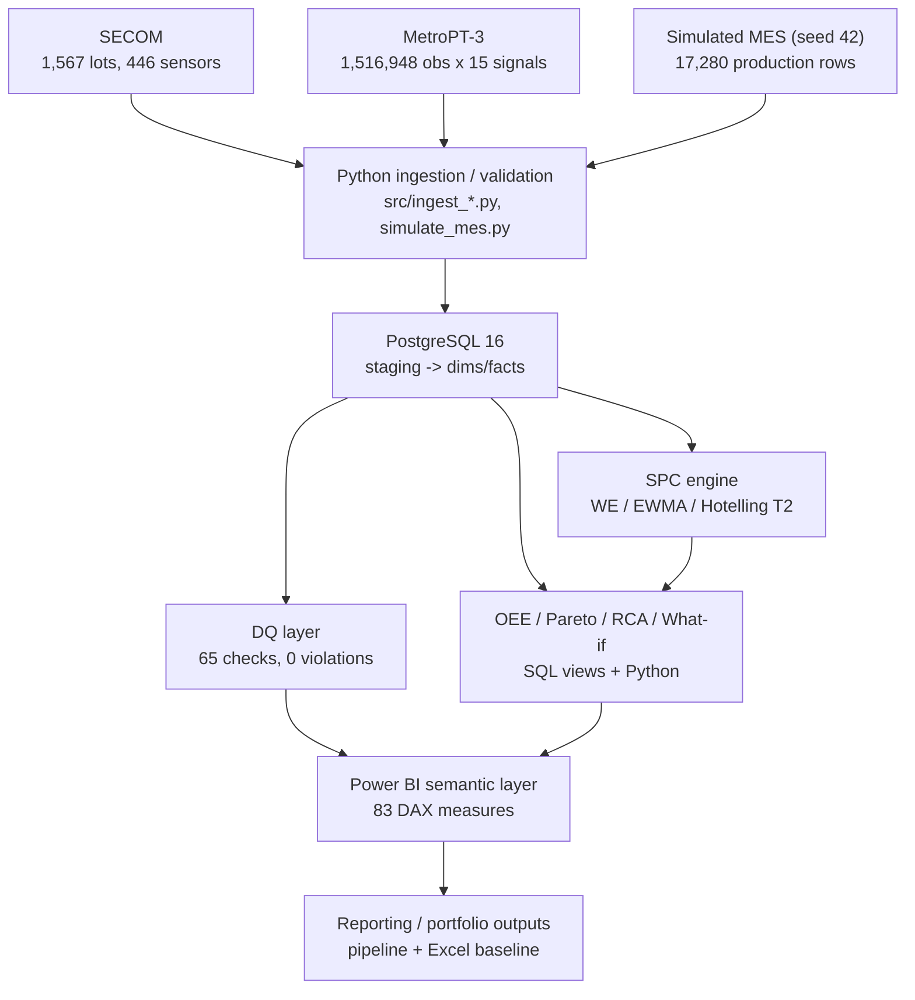

# Architecture

End-to-end data flow and analytical lineage for the Production Yield Loss & OEE Early-Warning System. Both diagrams render on GitHub (Mermaid) and match the repository as committed.

## Diagram 1 — System pipeline

Stage order is enforced by `src/run_pipeline.py` (14 stages): `ingest_secom`, `ingest_metropt3`, `simulate_mes`, `load_db`, `run_dq_checks`, `feature_screening`, `spc_engine`, `spc_backtest`, `rca_pareto`, `rca_statistical`, `oee_whatif`, `manual_baseline`, `powerbi_model`, `dashboard_spec`.

## Diagram 2 — Analytical lineage

Traceability rule: every headline number traces source → processed data → PostgreSQL → analytical module → report → Power BI/documentation. `reports/cross_system_reconciliation.csv` is the audit trail; `reports/impact_metrics.csv` is the single source for portfolio claims.
